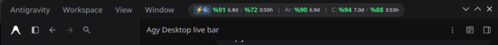

# antigravity-desktop-live-quota-mcp

**English** · [Türkçe](./README.tr.md)

[](./LICENSE)
[](https://github.com/Mefamex/antigravity-desktop-live-quota-mcp/releases)
[](https://www.python.org/)
[](./pyproject.toml)
[](#4-tech-stack--prerequisites)

**See your AI model quotas at a glance — right in the Antigravity title bar.**

Google Antigravity Desktop hides your Gemini, Claude and GPT quotas behind menus. This tool puts them where you can always see them: a live badge in the window's title bar with remaining percentages, reset countdowns and the model you're using right now. It is also a zero-dependency MCP server, so your AI agents can query the same quota data.

<p align="center">
  
</p>

```bash
git clone https://github.com/Mefamex/antigravity-desktop-live-quota-mcp.git
cd antigravity-desktop-live-quota-mcp
make install   # then fully restart Antigravity Desktop once
```

> **What is Antigravity?** [Google Antigravity](https://antigravity.google/) is Google's agentic IDE / desktop app for working with AI coding agents (Gemini, Claude, GPT). Its usage is limited by rolling 5-hour and weekly quotas per model group.

|              |                                                              |
| ------------ | ------------------------------------------------------------ |
| **Author**   | [Mefamex (Mehmet Akif Akkoç)](https://github.com/Mefamex)    |
| **Website**  | [https://www.mefamex.com](https://www.mefamex.com)           |
| **License**  | MIT                                                          |
| **Stack**    | Python ≥ 3.10, pure standard library (zero dependencies)     |
| **Platform** | Linux (Arch, Ubuntu, Wayland/X11) & Windows 11               |
| **Status**   | ✅ Production ready (v1.4.0)                                  |

---

## 1. Architecture & Preview

### Data Flow

```text
[ Antigravity Desktop Window ]
         │
         ├── DevToolsActivePort ──> [ discovery.py ] ──> [ cdp_client.py (RFC-6455) ]
         │                                                      │
         └── language_server   ──> [ quota_client.py ] ────────┴──> [ title-menu-bar ]
              (ConnectRPC)           (forceRefresh=true)               (live badge)
```

The badge is injected into the title bar (`[data-testid="title-menu-bar"]`) over the Chrome DevTools Protocol. Quota data comes from Antigravity's own local `language_server` — nothing leaves your machine.

### Key Metrics

- **Cold start:** `~56–68 ms` (about 6× faster than the official Python MCP SDK).
- **Memory:** `~9–12 MB RAM` (no extra runtime or virtualenv).
- **External dependencies:** `0` (standard library only: `socket`, `fcntl`, `struct`, `urllib`).
- **UI footprint:** `~400 px` wide, `24 px` tall — does not squeeze the title bar controls.

---

## 2. Repository Doc Map

| File | Purpose |
| :--- | :--- |
| [`README.md`](./README.md) | Project overview, architecture and usage guide (this file) |
| [`README.tr.md`](./README.tr.md) | Turkish version of this README |
| [`SECURITY.md`](./SECURITY.md) | Security model and the local CDP trade-off |
| [`NOTES.md`](./NOTES.md) | Internal technical memory, rejected approaches, constraints (Turkish) |
| [`TODO.md`](./TODO.md) / [`TODO.DONE.md`](./TODO.DONE.md) | Roadmap and completed-work log (Turkish) |
| [`config.py`](./config.py) | 3-layer settings engine (`ENV > config.py > defaults`) |
| [`Makefile`](./Makefile) | Self-documenting lifecycle commands (`make help`) |
| [`install.sh`](./install.sh) | One-command MCP registration and badge injection |

---

## 3. Key Features

* **All 5 quota types in one place:** `⚡G` (Gemini Flash/Pro and others, 5-hour and weekly), `Ar` (Gemini Argon, weekly) and `C` (Claude/GPT, 5-hour and weekly), tracked at the same time.
* **Live reset countdowns:** computed from `resetTime` instead of static labels (`0:50h`, `6.8d`, `7.0d`). A local DOM loop (every 5 s) ticks the timers without any network traffic.
* **Active model highlight:** the model used in the current chat is matched against the API's `quota.groups[].description` / `displayName` (with keyword fallback so new models are picked up automatically), and its label (`⚡G:`, `Ar:`, `C:`) is highlighted with a bright pill and soft glow.
* **Click to force refresh:** clicking the badge sends `{ forceRefresh: true }` to refresh the language server's cache. A monotonic sequence (`fetchSeq`) stops stale responses from overwriting fresh data.
* **Rate-limit friendly:** background polling is tuned to avoid cloud rate limits (`60 s` browser loop, `120 s` notification check, no double refresh while the badge is active), and the working `language_server` endpoint is cached for instant local calls.
* **Full RFC-6455 WebSocket client, no dependencies:** reassembles fragmented frames and handles `Ping`/`Pong`/`Close` control frames. The in-page `MutationObserver` is debounced with `requestAnimationFrame` to avoid needless re-injection on React re-renders.
* **Multi-window safe:** an OS file lock (`fcntl.flock`) elects a single `LEADER` when several windows or CLIs run. Others wait in `STANDBY` and take over automatically if the leader exits.
* **Responsive styling:** `clamp(6px, 1vw, 12px)` and `flex-shrink: 0` keep the badge readable on HiDPI and fractional-scaling displays.
* **Burn-rate analytics:** separate history buffers for the 5-hour Gemini (`g5h`) and Claude/GPT (`c5h`) buckets. The tooltip shows hourly usage and estimated time to depletion (`🔥 ~X%/hr (Est. depletion: ~Ym)`); a bucket's history resets automatically when its quota refills by more than 5%.
* **Desktop notifications:** a native notification (`notify-send` on Linux) when a quota drops to a critical level (`≤ 15%`) or refills back to `90%+`, with a 30-minute anti-spam cooldown.
* **Portable install:** `install.sh` resolves the real `antigravity` binary from `$PATH` and standard locations (skipping the managed wrapper to avoid recursion).
* **One-click scratch cleanup:** the `clean_scratch_cache` tool and `make clean-scratch` safely remove temporary session leftovers from Antigravity's brain directory.

---

## 4. Tech Stack & Prerequisites

- **OS:** Linux (Arch, Ubuntu, Debian, Fedora, … — Wayland or X11) and Windows 11 (`v1.4.0+`).
- **Interpreter:** Python ≥ 3.10 (system Python is fine, no virtualenv needed).
- **Target app:** Google Antigravity Desktop 2.x.
- **External dependencies:** none (`dependencies = []`, no `pip` or `npm` packages).

---

## 5. Installation & Quick Start

### 1. Clone the repository
```bash
git clone https://github.com/Mefamex/antigravity-desktop-live-quota-mcp.git
cd antigravity-desktop-live-quota-mcp
```

### 2. Install with one command
```bash
# Registers the MCP server, sets permissions, installs the persistent CDP launcher (2.33+) and injects the badge
make install
```

> **Note for Antigravity Desktop ≥ 2.33.0:** starting with `2.33.0`, Google turned off the default `--remote-debugging-port=0` switch. `make install` (or `make enable-cdp` on its own) sets up `~/.local/share/applications/antigravity.desktop` and `~/.local/bin/antigravity` so they survive app updates — no `sudo` needed. After the first install, fully close and reopen Antigravity Desktop once. If you don't want to open the local CDP debugging port, use `./install.sh --no-cdp-launcher` to get only the MCP quota tools and desktop notifications (see [Section 8](#8-security--privacy)).

#### Windows 11 quick start (`v1.4.0+`)
```powershell
python -B main.py --enable-cdp-windows
# Fully close and reopen Antigravity Desktop, then:
python -B main.py --status
python -B main.py --inject
```
To start it automatically in the background, run `scripts\install-windows-startup.cmd`.

### 3. Manual setup (alternative)
Add this entry to the `"mcpServers"` block in `~/.gemini/config/mcp_config.json`:

```json
"antigravity-desktop-live-quota-mcp": {
  "command": "python3",
  "args": [
    "-B",
    "/path/to/antigravity-desktop-live-quota-mcp/main.py"
  ],
  "disabled": false
}
```

---

## 6. Configuration

[`config.py`](./config.py) applies 3 layers of settings:
```text
Environment variable (ENV)  ──>  config.py constants  ──>  safe in-code defaults
```

Any setting can be overridden with an environment variable, without touching the code:

| Variable | Default | Description |
| :--- | :--- | :--- |
| `AGY_BROWSER_FETCH_MS` | `60000` | How often the in-page JS loop polls the local quota (ms) |
| `AGY_WATCHER_CHECK_SEC` | `8` | How often the leader checks that the window and badge exist (s) |
| `AGY_WATCHER_NOTIFY_SEC` | `120` | How often the leader checks quotas for desktop notifications (s) |
| `AGY_UI_INJECTION_ENABLED` | `true` | Controls the background watcher thread (`UIWatcherThread`). `false` disables both automatic badge injection and background notifications; only the on-demand MCP stdio tools keep working |
| `AGY_THRESHOLD_HIGH` | `50` | Green indicator threshold (`> 50%`) |
| `AGY_THRESHOLD_LOW` | `20` | Yellow indicator threshold (`> 20%`, red below) |
| `AGY_PULSE_ALERT_THRESHOLD_PCT` | `15` | Critical quota red pulse animation threshold (`≤ 15%`) |
| `AGY_ENABLE_PULSE_ALERT` | `true` | Enables the pulse animation |
| `AGY_ENABLE_NOTIFICATIONS` | `true` | Enables desktop notifications |
| `AGY_NOTIFY_THRESHOLD_PCT` | `15` | Critical quota notification threshold (`≤ 15%`) |
| `AGY_NOTIFY_COOLDOWN_MIN` | `30` | Cooldown between repeated alerts for the same quota pool (min) |
| `AGY_ENABLE_RESET_NOTIFY` | `true` | Sends a notification when a quota refills to `90%+` |

---

## 7. Usage & CLI Reference

### 7.1. Make targets

```bash
make help           # List all targets with descriptions
make status         # Print the live quota report and open windows as JSON
make inject         # Force-inject the badge into the open Antigravity window
make enable-cdp     # Install the user-level persistent CDP launcher (2.33+)
make test-notify    # Send a sample critical-quota desktop notification
make test           # Run cold start, leader lock, failover and injection tests
make verify         # Clean build leftovers and run the full test chain (pre-commit/push)
make clean          # Remove bytecode and cache leftovers
make clean-scratch  # Remove Antigravity brain scratch/ temporary session files
```

### 7.2. MCP tools

AI agents (`gemini`, `claude`, `codex`, …) can call these tools over stdio:

| Tool | Parameters | What it does |
| :--- | :--- | :--- |
| `get_quota_status` | `include_raw: bool`<br>`force_refresh: bool` | Returns Gemini, Claude/GPT and Argon quota percentages, time until reset, and optionally the raw language_server output. |
| `reinject_badge` | `force: bool` | Rebuilds the badge in the Antigravity Desktop window and refreshes it with current data. |
| `get_instance_status` | *(none)* | Reports the process PID, its `LEADER` / `STANDBY` role and the active lock file path. |
| `clean_scratch_cache` | `dry_run: bool`<br>`older_than_hours: float` | Safely removes temporary scratch files under Antigravity's brain directory. |

---

## 8. Security & Privacy

- **No external network traffic:** neither the server nor the injected script sends data to any external server or analytics service.
- **Localhost only:** all communication stays on `127.0.0.1` sockets and the local `language_server` process.
- **The local CDP trade-off (`--remote-debugging-port=0`):** the default launcher adds this flag, which opens a DevTools socket on the `127.0.0.1` loopback interface. It is not reachable from the network, but other local processes running as the same OS user could connect to the app over CDP (`Runtime.evaluate`) — which is why Antigravity `2.33.0+` turned remote debugging off by default. If you want strict process isolation, install with `./install.sh --no-cdp-launcher`: no CDP launcher overrides are created, and you still get the MCP quota tools and background notifications. To also stop the background watcher and notifications, set `AGY_UI_INJECTION_ENABLED=false`. See [`SECURITY.md`](./SECURITY.md) for details.
- **Clean stdout:** nothing is logged to `stdout`, so the JSON-RPC 2.0 stream stays intact; all logs go to `sys.stderr`.
- **No binary patching:** Antigravity Desktop's binaries are never modified; the UI is changed only through the Chrome DevTools Protocol (`Runtime.evaluate`).

---

## 9. License & Contributing

Released under the **MIT License** — see [`LICENSE`](./LICENSE).
Issues and pull requests are welcome. If this saves you a few clicks, a ⭐ helps others find it.

© 2026 [Mefamex](https://www.mefamex.com)
