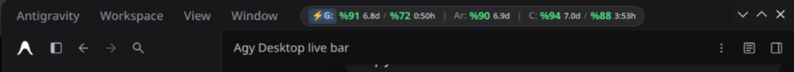

# antigravity-desktop-live-quota-mcp

|              |                                                               |
| ------------ | ------------------------------------------------------------- |
| **Author**   | [Mefamex (Mehmet Akif Akkoç)](https://github.com/Mefamex)      |
| **Website**  | [https://www.mefamex.com](https://www.mefamex.com)            |
| **License**  | MIT                                                           |
| **Created**  | 2026-11-07                                                    |
| **Updated**  | 2026-11-07                                                    |
| **Python**   | ≥ 3.10 (Sıfır Harici Bağımlılık / Pure Python Stdlib)         |
| **Platform** | Linux (Arch Linux, KDE Plasma 6, Wayland, X11)                |
| **Target**   | Google Antigravity Desktop (2.0)                              |
| **Status**   | ✅ **Complete — Production Ready**                             |

Zero-dependency Model Context Protocol (MCP) server and persistent Chrome DevTools Protocol (CDP) live UI quota badge injector for **Google Antigravity Desktop**.

Antigravity Desktop uygulamasında menüler altında gizli kalan **canlı model kullanım kotalarını (5 saatlik ve haftalık limitler)**, aktif konuşulan modeli ve kalan geri sayım sürelerini hiçbir harici arka plan servisi (`systemd` vb.), sanal ortam (`venv`) veya ek tıklama gerektirmeden doğrudan uygulamanın üst başlık çubuğuna (`[data-testid="title-menu-bar"]`) enjekte eder. Aynı zamanda yapay zekâ ajanlarına JSON-RPC 2.0 `stdio` üzerinden anlık kota ve çalışma durumu araçları sağlar.

---

## 📸 Canlı Görünüm (Live Badge Interface)

<p align="center">
  
</p>

- **Konum:** Üst menü çubuğunun menü butonlarının hemen yanında sola yaslı (`margin-left: clamp(6px, 1vw, 12px); margin-right: auto;`).
- **Genişlik:** ~400px (Pencere başlığını veya düğmeleri sıkıştırmayan adaptif ultra-kompakt kapsül).
- **Etkileşim:** Tek tıkla anında bulut önbelleğini temizleyip zorlamalı yenileme (`forceRefresh: true`); üzerine gelindiğinde (hover) her modelin detaylı sıfırlanma takvimini içeren zengin araç ipucu (tooltip).

---

## ⚡ Temel Yetenekler (Key Features)

1. **5 Kota Türünün Tam Entegrasyonu:**
   - **`⚡G:`** Gemini Modelleri (Flash / Pro) — Haftalık ve 5 Saatlik kota yüzdesi.
   - **`Ar:`** Gemini 4 Argon — Haftalık kota yüzdesi.
   - **`C:`** Claude & GPT Modelleri — Haftalık ve 5 Saatlik kota yüzdesi.
2. **Dinamik Kalan Süre Sayacı (Live Countdown Tags):**
   - 5 saatlik kotalar için anlık saat:dakika formatı (`1:20h`, `2:07h`).
   - Haftalık kotalar için kalan gün formatı (`3.5d`, `6.9d`).
   - Ağ trafiği oluşturmadan sadece süreyi akıtan 5 saniyelik yerel DOM render döngüsü.
3. **Aktif Model Vurgusu (Active Model Accent Highlight):**
   - Açık olan sohbette hangi model seçiliyse (`Select model, current: ...`), rozetteki ilgili etiket (`⚡G:`, `Ar:`, `C:`) parlak renk, kapsül arka plan ve ışıltı (`text-shadow`) efektiyle öne çıkar.
4. **Yapılandırılabilir Kritik Eşik Nabız Uyarısı (Subtle Pulse Alert):**
   - Kotalardan herhangi biri kritik eşiğin altına indiğinde (varsayılan: `≤ %15`) dikkat dağıtmayan zarif kırmızı CSS nabız animasyonu (`@keyframes agy-quota-pulse`) devreye girer.
5. **Sıfır Bağımlılık (Pure Stdlib Python):**
   - Harici `pip` veya `npm` paketi gerektirmez (`mcp`, `websockets`, `pydantic` YOKTUR).
   - Python sürümü güncellense dahi paket kırılması yaşanmaz, `venv` gerektirmez, soğuk başlangıç süresi **~75-100 ms**'dir.
6. **Çift Katmanlı Çakışma Önleme (Multi-Instance Lock & Failover):**
   - Aynı anda birden fazla Antigravity veya `agy` CLI süreci açıldığında Linux çekirdek kilidi (`fcntl.flock`) ile tek bir **`LEADER`** seçilir. Diğerleri **`STANDBY`** modda bekler.
   - Lider süreç kapanırsa yedekteki süreç anında liderliği devralır (Otomatik Failover).

---

## 🏗️ Mimari Tasarım ve Modül Yapısı

```text
antigravity-desktop-live-quota-mcp/
├── README.md               # Proje tanıtımı ve kullanım kılavuzu
├── NOTES.md                # Dahili teknik bellek ve mimari karar kayıtları
├── TODO.md                 # Önceliklendirilmiş geliştirme listesi
├── TODO.DONE.md            # Zaman damgalı tamamlanan adımlar arşivi
├── Makefile                # Self-documenting görev yöneticisi (6 zorunlu hedef + testler)
├── pyproject.toml          # Proje meta verisi (0 harici bağımlılık)
├── install.sh              # Tek tıkla mcp_config.json kurulum otomasyonu
├── config.py               # 3 katmanlı (varsayılan < config < env) ayar dosyası
├── main.py                 # Giriş noktası (MCP Stdio Server + CLI --status / --inject)
├── src/
│   ├── __init__.py
│   ├── logger.py           # Sadece stderr'e yazan, 4-harf hizalı MCP uyumlu logger
│   ├── models.py           # Tip güvenli veri modelleri (QuotaReport, GroupQuota, BucketQuota)
│   ├── lock.py             # fcntl.flock tabanlı Lider Seçimi (Leader Election)
│   ├── discovery.py        # language_server (PID/token/port) ve CDP hedef keşfi
│   ├── quota_client.py     # ConnectRPC RetrieveUserQuotaSummary istemcisi (ham veri korumalı)
│   ├── cdp_client.py       # Sıfır bağımlılıklı RFC-6455 yerel WebSocket CDP istemcisi
│   ├── ui_payload.py       # Tarayıcıya enjekte edilen dinamik JS/CSS rozet yükü
│   ├── ui_watcher.py       # Lider süreçte çalışan arka plan pencere izleyicisi
│   └── mcp_stdio.py        # Sıfır bağımlılıklı JSON-RPC 2.0 MCP Stdio sunucusu
└── tests/
    └── verify_all.py       # Soğuk başlangıç, çoklu örnek kilit, failover ve CDP testi
```

---

## 🚀 Hızlı Başlangıç ve Kurulum

### 1. Tek Komutla Otomatik Kurulum
```bash
cd /mnt/DiskD/SOFTWARE/Github-repos/antigravity-desktop-live-quota-mcp
chmod +x install.sh
./install.sh
```
Bu betik `~/.gemini/config/mcp_config.json` dosyasını otomatik olarak günceller ve açık olan Antigravity Desktop penceresine rozeti anında enjekte eder.

### 2. Manuel MCP Kaydı
Dilerseniz `~/.gemini/config/mcp_config.json` dosyasına doğrudan şu kaydı ekleyebilirsiniz:

```json
"antigravity-desktop-live-quota-mcp": {
  "command": "python3",
  "args": [
    "-B",
    "/mnt/DiskD/SOFTWARE/Github-repos/antigravity-desktop-live-quota-mcp/main.py"
  ],
  "disabled": false
}
```

---

## 🛠️ Kullanım ve Test Komutları

```bash
# Canlı kotayı, açık pencereleri ve lider durumunu terminalde JSON olarak gör:
make status

# Açık olan Antigravity Desktop pencerelerine rozeti hemen enjekte et:
make inject

# Soğuk başlangıç, çoklu örnek kilit, failover ve CDP testlerini koştur:
make test

# Derleme ve bytecode önbelleğini temizle:
make delCache
```

---

## 🔌 Sunulan MCP Araçları (Tools)

Yapay zekâ ajanları (`gemini`, `claude`, `codex`) bu MCP sunucusu üzerinden şu araçları çağırabilir:

| Araç Adı | Parametreler | Açıklama |
| --- | --- | --- |
| **`get_quota_status`** | `include_raw: bool` | Gemini, Claude/GPT ve Argon kalan kota yüzdelerini, dinamik sıfırlanma zamanlarını ve istenirse ham language_server yanıtını döndürür. |
| **`reinject_badge`** | `force: bool` | Antigravity Desktop pencere üst çubuğundaki canlı kota rozetini anında yeniden takar. |
| **`get_instance_status`** | *(yok)* | Sürecin PID numarasını, `LEADER` / `STANDBY` rolünü ve aktif kilit sahibini döndürür. |

---

## ⚙️ Yapılandırma ve Ortam Değişkenleri (Configuration)

[`config.py`](file:///mnt/DiskD/SOFTWARE/Github-repos/antigravity-desktop-live-quota-mcp/config.py) dosyası 3 katmanlı ayar önceliği (`kod içi varsayılanlar < config.py < ortam değişkenleri`) ile çalışır:

| Değişken | Varsayılan | Açıklama |
| --- | --- | --- |
| `AGY_BROWSER_FETCH_MS` | `30000` | Tarayıcı JS döngüsünün yerel kota sorgulama sıklığı (ms). |
| `AGY_WATCHER_CHECK_SEC` | `8` | Lider MCP sürecinin pencere varlığını kontrol sıklığı (sn). |
| `AGY_THRESHOLD_HIGH` | `50` | Yeşil renk eşiği (`> %50`). |
| `AGY_THRESHOLD_LOW` | `20` | Sarı renk eşiği (`> %20`, altı kırmızı). |
| `AGY_PULSE_ALERT_THRESHOLD_PCT` | `15` | Nabız uyarısı eşiği (`≤ %15` kırmızı pulse tetikler). |
| `AGY_ENABLE_PULSE_ALERT` | `true` | Nabız animasyonunu aktif/pasif yapar. |

---

## 📄 Lisans

Bu proje **MIT Lisansı** kapsamında açık kaynak olarak yayınlanmıştır.
Tüm hakları saklıdır © 2026 [Mefamex](https://www.mefamex.com).
