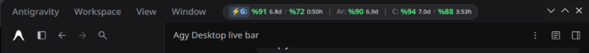

# antigravity-desktop-live-quota-mcp

[English](./README.md) · **Türkçe**

|              |                                                               |
| ------------ | ------------------------------------------------------------- |
| **Author**   | [Mefamex (Mehmet Akif Akkoç)](https://github.com/Mefamex)      |
| **Website**  | [https://www.mefamex.com](https://www.mefamex.com)            |
| **License**  | MIT                                                           |
| **Created**  | 2026-11-07                                                    |
| **Updated**  | 2026-11-23                                                    |
| **Stack**    | Python ≥ 3.10 (Sıfır Harici Bağımlılık / Pure Python Stdlib)  |
| **Platform** | Linux (Arch, Ubuntu, Wayland/X11) & Windows 11                |
| **Status**   | ✅ Production Ready                                            |

Google Antigravity Desktop (2.0) uygulamasında menüler altında gizli kalan canlı yapay zekâ model kotalarını, sıfırlanma geri sayımlarını ve aktif seçili modeli doğrudan pencerenin üst başlık çubuğuna (`[data-testid="title-menu-bar"]`) enjekte eden, sıfır bağımlılıklı hafif bir Model Context Protocol (MCP) sunucusudur. Harici bir sistem servisi veya paket yöneticisi yükü getirmeden yapay zekâ ajanlarına anlık kota telemetrisi sağlar.

---

## 1. Mimari ve Görsel Önizleme (Architecture & Preview)

### Sistem Veri Akış Şeması

```text
[ Antigravity Desktop Window ]
         │
         ├── DevToolsActivePort ──> [ discovery.py ] ──> [ cdp_client.py (RFC-6455) ]
         │                                                      │
         └── language_server   ──> [ quota_client.py ] ────────┴──> [ title-menu-bar ]
              (ConnectRPC)           (forceRefresh=true)               (Canlı Rozet)
```

### Arayüz Önizlemesi

<p align="center">
  
</p>

### Kritik Mimari Metrikleri

- **Soğuk Başlangıç Gecikmesi:** `~56 ms — 68 ms` (Resmi Python MCP SDK'sına göre ~6 kat daha hızlı).
- **Bellek Tüketimi:** `~9 — 12 MB RAM` (Ekstra runtime veya sanal ortam yükü yoktur).
- **Harici Bağımlılık:** `0` (Yalnızca Python standart kütüphanesi: `socket`, `fcntl`, `struct`, `urllib`).
- **Arayüz Etki Alanı:** `~400 px` genişlik, `24 px` yükseklik (Başlık çubuğu kontrollerini sıkıştırmaz).

---

## 2. Belge Haritası (Repository Doc Map)

| Belge | Amacı ve Sorumluluğu |
| :--- | :--- |
| [`README.md`](./README.md) | Proje vitrini (İngilizce) |
| [`README.tr.md`](./README.tr.md) | Proje vitrini, mimari detaylar ve operasyonel kullanım kılavuzu (bu dosya) |
| [`NOTES.md`](./NOTES.md) | Dahili teknik bellek, elenen yöntemler, sistem kısıtları ve Git referansı |
| [`TODO.md`](./TODO.md) | 5 seviyeli görev takibi, aktif sprint ve gelecek yol haritası |
| [`TODO.DONE.md`](./TODO.DONE.md) | Tamamlanan ve doğrulanan adımların ters kronolojik teknik günlüğü |
| [`config.py`](./config.py) | 3 katmanlı ayar motoru (`Ortam Değişkeni > config.py > Varsayılanlar`) |
| [`Makefile`](./Makefile) | Marmelab self-documenting yaşam döngüsü yöneticisi (6 zorunlu hedef + testler) |
| [`install.sh`](./install.sh) | Tek komutla `mcp_config.json` kaydı ve otomatik enjeksiyon betiği |

---

## 3. Temel Yetenekler ve Özellikler (Key Features)

* **5 Kota Türünün Tam Entegrasyonu:** `⚡G` (Gemini Flash/Pro/Neon/Hydrogen/Orchestrator 5h ve haftalık), `Ar` (Gemini 4 Argon haftalık) ve `C` (Claude/GPT 5h ve haftalık) kotalarını eşzamanlı izler.
* **Dinamik Kalan Süre Sayacı:** Statik etiketler yerine `resetTime` verisinden canlı hesaplanan geri sayımları gösterir (`0:50h`, `6.8d`, `7.0d`). Yerel DOM döngüsü (5 sn) ağ trafiği üretmeden süreyi akıtır.
* **Dinamik Aktif Model Vurgusu:** Sohbet oturumunda kullanılan modeli API'nin `quota.groups[].description` ve `displayName` alanlarına karşı dinamik olarak eşleştirir (yeni çıkacak modellerin otomatik tanınması için anahtar kelime yedeklemesiyle birlikte) ve ilgili etiketi (`⚡G:`, `Ar:`, `C:`) parlak arka plan kapsülü ve hafif ışıltı ile görsel olarak öne çıkarır.
* **Anında Zorlamalı Yenileme, Bulut RPC Kısıtlaması ve Uç Nokta Önbelleği:** Rozete tıklandığında `{ forceRefresh: true }` parametresi gönderilerek yerel dil sunucusunun önbelleği tazelenir; monoton sıralama (`fetchSeq`) eski yanıtların taze veriyi ezmesini önler. Arka plan sorguları bulut hız sınırlarına (rate-limit) karşı optimize edilmiştir (`60000 ms` tarayıcı döngüsü, `120 sn` bildirim denetimi ve arayüz rozeti aktifken çift bulut yenilemesinden kaçınma) ve çalışan `language_server` uç noktası (`_CACHED_ENDPOINT`) önbelleklenerek sonraki yerel çağrılar gecikmesiz yanıtlanır.
* **Tam RFC-6455 WebSocket & Debounce Edilmiş DOM Gözlemcisi:** Harici bağımlılık olmadan parçalı (fragmented) WebSocket çerçevelerini (`0x01`/`0x00`) yeniden birleştirir ve sunucu `Ping`/`Pong` (`0x09`/`0x0A`) ile `Close` (`0x08`) kontrol çerçevelerini tam uyumlu işler. Pencere içi `MutationObserver`, `requestAnimationFrame` ile debounce edilerek React DOM mutasyonlarında gereksiz yeniden enjeksiyon yükünü ortadan kaldırır.
* **Çift Katmanlı Çakışma Koruması:** Linux çekirdek kilidi (`fcntl.flock`) ile birden fazla pencere/CLI açıldığında tek bir `LEADER` belirlenir. Diğer süreçler `STANDBY` modunda bekler; lider kapanırsa otomatik devir (failover) gerçekleşir.
* **Adaptif ve Responsive Stil:** HiDPI ve fractional scaling ekranlar için `clamp(6px, 1vw, 12px)` ve `flex-shrink: 0` CSS kuralları ile pencere genişliğine uyum sağlar.
* **Kova Bazlı Tüketim Hızı & Sıfırlama İzolasyonu (Burn-Rate Analytics):** 5 saatlik Gemini (`g5h`) ve Claude/GPT (`c5h`) kotaları için ayrı geçmiş tamponları tutar; kota `> +%5` oranında dolduğunda ilgili kovanın geçmişini otomatik sıfırlar ve rozet ipucunda saatlik tüketim hızı ile tahmini tükenme süresini (`🔥 ~X%/hr (Est. depletion: ~Ym)`) gösterir.
* **Kritik Kota & Yenilenme Masaüstü Bildirimleri:** Kota kritik eşiğe (`<= %15`) düştüğünde veya sayaç sıfırlanıp `%90+` seviyesine yenilendiğinde Linux masaüstüne (`notify-send`) 30 dk anti-spam korumalı yerel bildirim gönderir.
* **Taşınabilir Kurulum & İngilizce Çekirdek Standardizasyonu (`v1.3.0`):** `install.sh`, sistemdeki gerçek `antigravity` ikili dosyasını `$PATH` ve standart yollar üzerinden dinamik olarak çözer (yönetilen sarmalayıcıyı atlayarak özyineleme döngüsünü önler). Tüm kaynak kod, loglar, testler ve arayüz rozet metinleri (`99%`, `Live Quota Status`) İngilizce olarak standartlaştırılmıştır.
* **Tek Tıkla Scratch Temizliği:** Antigravity brain dizininde biriken geçici oturum kalıntılarını güvenle temizleyen `clean_scratch_cache` aracı ve `make clean-scratch` komutu.

---

## 4. Teknoloji Yığını ve Gereksinimler (Tech Stack & Prerequisites)

- **Çalışma Ortamı:** Linux (Arch Linux, Ubuntu, Debian, Fedora vb. — Wayland veya X11) ve Windows 11 (`v1.4.0+`).
- **Yorumlayıcı:** Python ≥ 3.10 (Sanal ortam gerektirmez, sistem Python'u ile çalışır).
- **Hedef Uygulama:** Google Antigravity Desktop (2.0) sürümü.
- **Harici Bağımlılıklar:** `dependencies = []` (Harici hiçbir `pip` veya `npm` paketi gerekmez).

---

## 5. Kurulum ve Hızlı Başlangıç (Installation & Quick Start)

### 1. Depoyu Klonlayın ve Dizine Girin
```bash
git clone https://github.com/Mefamex/antigravity-desktop-live-quota-mcp.git
cd antigravity-desktop-live-quota-mcp
```

### 2. Tek Komutla Otomatik Kurun
```bash
# MCP kaydını yapar, izinleri ayarlar, 2.33+ kalıcı CDP launcher'ını kurar ve rozeti enjekte eder
make install
```

> **Antigravity Desktop ≥ 2.33.0 Notu:** Google, Antigravity `2.33.0` sürümünden itibaren varsayılan `--remote-debugging-port=0` anahtarını kapattı. `make install` (veya tek başına `make enable-cdp`) komutu `sudo` gerektirmeden `~/.local/share/applications/antigravity.desktop` ve `~/.local/bin/antigravity` dosyalarını güncellemelerden etkilenmeyecek şekilde ayarlar (sistemdeki gerçek `antigravity` ikili dosyasını `$PATH` üzerinden dinamik olarak çözer). İlk kurulum sonrası çalışan Antigravity Desktop penceresini bir kez tamamen kapatıp yeniden açmanız yeterlidir. Yerel CDP hata ayıklama portunu açmak istemiyorsanız yalnızca MCP kota araçları ve masaüstü bildirimleri için `./install.sh --no-cdp-launcher` kullanabilirsiniz (bkz. Bölüm 8).

#### Windows 11 Hızlı Başlangıç (`v1.4.0+`)
```powershell
python -B main.py --enable-cdp-windows
# Antigravity Desktop uygulamasını tamamen kapatıp yeniden açın, ardından:
python -B main.py --status
python -B main.py --inject
```
İsteğe bağlı arka plan otomatik başlatma için `scripts\install-windows-startup.cmd` çalıştırılabilir.

### 3. Manuel Kurulum Alternatifi
Dilerseniz `~/.gemini/config/mcp_config.json` dosyası içerisindeki `"mcpServers"` bloğuna doğrudan şu girdiyi ekleyebilirsiniz:

```json
"antigravity-desktop-live-quota-mcp": {
  "command": "python3",
  "args": [
    "-B",
    "/path/to/antigravity-desktop-live-quota-mcp/main.py"
  ],
  "disabled": false
}
```

---

## 6. Yapılandırma (Configuration Guide)

[`config.py`](./config.py) dosyası 3 katmanlı ayar önceliği uygular:
```text
Ortam Değişkeni (ENV)  ──>  config.py Sabitleri  ──>  Kod İçi Güvenli Varsayılanlar
```

Hassas veriler veya geçici ayarlar kod değiştirilmeden ortam değişkenleri üzerinden ezilebilir:

| Değişken | Varsayılan | Açıklama |
| :--- | :--- | :--- |
| `AGY_BROWSER_FETCH_MS` | `60000` | Tarayıcı JS döngüsünün yerel kota sorgulama periyodu (milisaniye) |
| `AGY_WATCHER_CHECK_SEC` | `8` | Lider sürecin pencere varlığını ve rozet durumunu denetleme sıklığı (saniye) |
| `AGY_WATCHER_NOTIFY_SEC` | `120` | Lider sürecin masaüstü bildirimleri için kota kontrol sıklığı (saniye) |
| `AGY_UI_INJECTION_ENABLED` | `true` | Arka plan izleyici iş parçacığını (`UIWatcherThread`) kontrol eder; `false` yapılırsa hem otomatik arayüz rozeti enjeksiyonu hem de arka plan masaüstü bildirimleri devre dışı kalır, yalnızca isteğe bağlı MCP stdio araçları çalışır |
| `AGY_THRESHOLD_HIGH` | `50` | Yeşil gösterge eşik yüzdesi (`> %50`) |
| `AGY_THRESHOLD_LOW` | `20` | Sarı gösterge eşik yüzdesi (`> %20`, altı kırmızı) |
| `AGY_PULSE_ALERT_THRESHOLD_PCT` | `15` | Kritik kota kırmızı nabız animasyonu eşiği (`≤ %15`) |
| `AGY_ENABLE_PULSE_ALERT` | `true` | Nabız animasyonunu etkinleştirme bayrağı |
| `AGY_ENABLE_NOTIFICATIONS` | `true` | Linux `notify-send` masaüstü bildirimlerini etkinleştirir |
| `AGY_NOTIFY_THRESHOLD_PCT` | `15` | Kritik kota masaüstü bildirimi eşik yüzdesi (`≤ %15`) |
| `AGY_NOTIFY_COOLDOWN_MIN` | `30` | Aynı kota havuzu için ardışık uyarılar arası bekleme süresi (dakika) |
| `AGY_ENABLE_RESET_NOTIFY` | `true` | Kota sıfırlanıp `%90+` seviyesine döndüğünde yenilenme bildirimi gönderir |

---

## 7. Kullanım ve Komutlar (Usage & CLI Reference)

### 7.1. Terminal ve Makefile Komutları

```bash
# Kullanılabilir tüm hedefleri renkli ve açıklamalı listeler
make help

# Canlı kota raporunu ve açık pencereleri JSON olarak terminale basar
make status

# Açık olan Antigravity Desktop penceresine rozeti anında zorla enjekte eder
make inject

# Antigravity 2.33+ için kullanıcı-seviyesi kalıcı CDP launcher override kurar
make enable-cdp

# Masaüstüne örnek bir kritik kota test bildirimi gönderir
make test-notify

# Soğuk başlangıç, liderlik kilidi, failover ve enjeksiyon testlerini koşturur
make test

# Commit/Push öncesi derleme kalıntılarını temizler ve test zincirini doğrular
make verify

# Ortamdaki bytecode ve önbellek kalıntılarını siler
make clean

# Antigravity brain scratch/ geçici oturum dosyalarını temizler
make clean-scratch
```

### 7.2. Sunulan Model Context Protocol (MCP) Araçları

Yapay zekâ ajanları (`gemini`, `claude`, `codex`) stdio üzerinden bu araçları çağırabilir:

| Araç Adı | Parametreler | Görev ve Açıklama |
| :--- | :--- | :--- |
| `get_quota_status` | `include_raw: bool`<br>`force_refresh: bool` | Gemini, Claude/GPT ve Argon kota yüzdelerini, kalan sıfırlanma sürelerini ve ham language_server çıktısını döndürür. |
| `reinject_badge` | `force: bool` | Antigravity Desktop penceresindeki rozeti yeniden oluşturur ve tıklandığı andaki verilerle tazeler. |
| `get_instance_status` | *(yok)* | Sürecin PID numarasını, `LEADER` / `STANDBY` rolünü ve aktif kilit dosya yolunu bildirir. |
| `clean_scratch_cache` | `dry_run: bool`<br>`older_than_hours: float` | Antigravity brain altındaki geçici oturum scratch dosyalarını güvenle temizler. |

---

## 8. Güvenlik, Gizlilik ve Kırmızı Çizgiler (Safety & Privacy)

- **Sıfır Dış Ağ Trafiği:** Bu sunucu ve enjekte edilen tarayıcı scripti, hiçbir harici sunucuya veya üçüncü taraf analitik servisine veri göndermez.
- **Sadece Yerel İletişim (Localhost-Only):** Tüm iletişim yerel makinedeki `127.0.0.1` soketleri ve `language_server` süreciyle sınırlıdır.
- **Yerel CDP Güvenlik Dengesi (`--remote-debugging-port=0`):** Varsayılan launcher kurulumunun eklediği `--remote-debugging-port=0` bayrağı, `127.0.0.1` loopback arayüzü üzerinde bir DevTools soketi açar. Bu soket ağa kapalı olsa da aynı işletim sistemi kullanıcısı altında çalışan diğer yerel süreçlerin CDP üzerinden (`Runtime.evaluate`) uygulamaya bağlanabilmesine olanak tanır — Antigravity Desktop `2.33.0+` sürümünde uzak hata ayıklamanın varsayılan olarak kapatılmasının nedeni de budur. Sıkı süreç izolasyonu isteyen ve yerel CDP hata ayıklama portunu açmadan yalnızca MCP kota araçları ile arka plan masaüstü bildirimlerini kullanmak isteyen kullanıcılar `./install.sh --no-cdp-launcher` komutuyla kurulum yapabilir (bu modda CDP launcher geçersiz kılmaları oluşturulmaz ve varsayılan `AGY_UI_INJECTION_ENABLED=true` ayarı korunur). Arka plan izleyici iş parçacığını (`UIWatcherThread`) ve masaüstü bildirimlerini de durdurup yalnızca isteğe bağlı MCP stdio araçlarının (`get_quota_status`, `clean_scratch_cache` vb.) çalışmasını istiyorsanız çalışma zamanında `AGY_UI_INJECTION_ENABLED=false` ayarlayın. Ayrıntılar için [`SECURITY.md`](./SECURITY.md) dosyasına bakın.
- **Stdout Akış İzolasyonu:** JSON-RPC 2.0 protokol bütünlüğünü bozmamak için `stdout` akışına kesinlikle log basılmaz; tüm operasyonel loglar `sys.stderr` üzerinden yürütülür.
- **Sıfır İkili Dosya Değişikliği:** Antigravity Desktop ikili dosyalarına (`binary patch`) dokunulmaz; yalnızca Chrome DevTools Protocol (`Runtime.evaluate`) üzerinden arayüz manipülasyonu yapılır.

---

## 9. Lisans ve Katkı (License)

Bu proje **MIT Lisansı** altında açık kaynak olarak yayınlanmıştır.  
Tüm hakları saklıdır © 2026 [Mefamex](https://www.mefamex.com).
